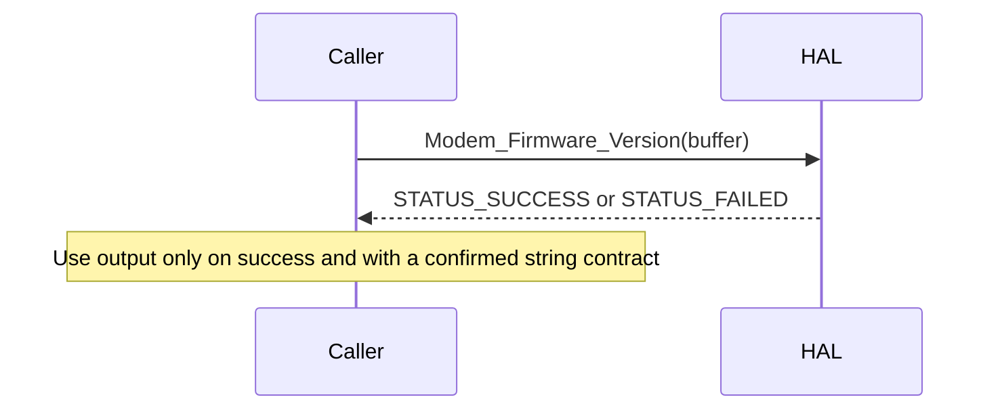

# Cellular Modem HAL

## Version history

This overview documents the declarations in `include/cellular_modem_hal_api.h`. It does not introduce an ABI version or change the interface.

## Acronyms

- HAL: Hardware Abstraction Layer.
- RDK-B: Reference Design Kit for Broadband.
- OEM: Original Equipment Manufacturer.

## Description

This interface provides exactly three operations: factory reset, reboot, and firmware-version retrieval. It does not export SIM control, modem discovery, network connection, signal queries, context handles, initialization, or deinitialization.

The caller invokes the public C interface; the vendor implementation accesses the modem. The public header, not an illustrative architecture diagram, determines the available operations.

## Component runtime execution requirements

### Initialization and startup

No initialization function is declared. Modem and vendor-service readiness must be established through platform integration. The header does not specify a readiness probe or startup timeout.

### Threading model

The legacy specification requires caller-side synchronization. The header does not establish reentrancy or callback-thread guarantees. Serialize access unless the implementation owner supplies a reviewed concurrency contract.

### Process model

The legacy specification anticipates multiple caller processes. Cross-process arbitration and vendor-library isolation require implementation confirmation; multiple callers do not imply thread safety.

### Memory model

The caller supplies storage for the firmware-version result. Allocate at least 128 bytes and retain it for the call. The API does not return a context or dynamically allocated result requiring a HAL-specific release function.

### Power management requirements

No dedicated power-management API is declared. Reboot is disruptive and must not be used as a prerequisite for a read-only query.

### Asynchronous notification model

No callback registration or asynchronous event API is declared.

### Blocking calls

These functions return an integer status. The header does not define maximum duration, cancellation, or whether successful reset/reboot return means service has recovered. Obtain timing and readiness requirements from the vendor before writing timeout-sensitive tests.

### Internal error handling

All three functions return `STATUS_SUCCESS` (0) or `STATUS_FAILED` (-1). The header describes possible failure causes but exports no detailed error retrieval function. Do not invent additional return values.

### Persistence model

Factory reset explicitly erases custom configuration and restores factory settings. The exact reset scope and persistence of other settings require vendor confirmation.

## Nonfunctional requirements

### Logging and debugging requirements

The legacy specification calls for syslog-style logging and identifies `cellular_modem_vendor_hal.log` under `/var/tmp/` or `/rdklogs/logs/`. Confirm target integration rather than assuming either path exists. Log operation status without exposing subscriber identifiers or credentials.

### Memory and performance requirements

The firmware-version output requires at least 128 bytes. No approved total memory budget or numeric execution deadline is defined. Product and implementation owners must establish measurable resource and timing limits before performance acceptance.

### Quality control

Compile callers with warnings enabled, review return handling, and run static and memory analysis where supported. Header documentation is not evidence of successful vendor or hardware tests. Factory-reset and reboot tests require explicit authorization and recovery procedures.

### Licensing

The public header is licensed under Apache License 2.0. Review the repository license and vendor implementation licensing separately.

### Build requirements

Include `cellular_modem_hal_api.h`. The legacy specification identifies a Linux Yocto shared library named `libhal_cellular_modem_hal_api.so`; verify the actual target package and linker configuration. The header supplies C++ linkage guards.

### Variability management

Match the deployed vendor implementation to the public header revision. No capability-discovery or interface-version query is declared.

### Platform or product customization

Hardware readiness, reset scope, concurrency, resource limits, and recovery timing remain platform-specific integration decisions.

## Interface API documentation

Authoritative reference: [public header](../../include/cellular_modem_hal_api.h).

### `int Modem_FactoryReset(void)`

Restores factory settings and erases custom configuration. Takes no arguments. Returns 0 on success or -1 on failure. The header lists configuration-storage, permission, hardware/firmware, and interruption failures as possible causes.

This is destructive. Confirm authorization and save any restorable configuration before use. Exact reset scope, completion timing, and post-reset readiness are unspecified.

### `int Modem_Reboot(void)`

Initiates modem shutdown and restart. Takes no arguments. Returns 0 on success or -1 on failure. Possible causes include unavailable resources, shutdown failure, hardware/firmware problems, and permission restrictions.

The return is not a documented network-readiness signal. Use an independently specified platform readiness check before dependent operations.

### `int Modem_Firmware_Version(char *firmware_version)`

Writes the current firmware version to caller-provided output storage of at least 128 bytes. Returns 0 on success or -1 on failure, including invalid arguments or retrieval failure.

The header does not specify null termination, truncation, maximum string length, or output contents after failure. Do not consume failed-call output. Obtain the string-format and termination contract before treating the result as an unrestricted C string.

## Theory of operation and key concepts

For a read-only query, establish platform readiness, allocate the output buffer, call `Modem_Firmware_Version()`, and check the result before using the output according to the vendor's termination contract.

There is no mandatory relative ordering among the three exported functions. No context creation, network connection, or teardown call is declared. Reset and reboot are separate controlled workflows.

## Sequence diagram

## Open contract requirements

The implementation owner must specify string termination and failure-output behavior, concurrency and cross-process coordination, maximum durations, reset scope, and post-reboot/reset readiness. These gaps must remain explicit rather than becoming invented test expectations.
