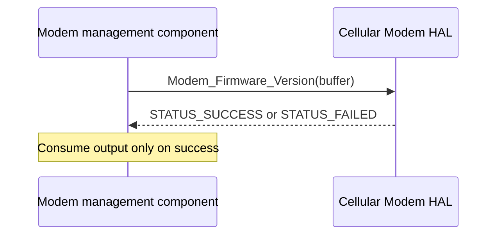

# Cellular Modem HAL Specification

## Version History

| Date | Comment | Version |
| --- | --- | --- |
| — | Documentation alignment; no ABI change. | — |

## Acronyms

HAL means Hardware Abstraction Layer; RDK-B means Reference Design Kit for Broadband.

## Description

The modem management component uses this C interface for factory reset, reboot, and firmware-version retrieval. Platform integration establishes modem and vendor-service readiness before calls.

## Component Runtime Execution Requirements

### Threading and Process Model

Serialize access and coordinate callers across processes with the vendor integration.

### Memory Model

The caller owns firmware-version output storage and must provide at least 128 bytes, valid throughout the call. Consume output only on success and according to the vendor's string-termination contract.

### Internal Error Handling

All three functions return `STATUS_SUCCESS` (`0`) or `STATUS_FAILED` (`-1`). A successful reboot or reset return is not a network-readiness signal; use the platform readiness check before dependent operations.

### Persistence Model

Factory reset erases custom configuration and restores factory settings. Authorize destructive operations and prepare product-specific recovery before use.

## Nonfunctional Requirements

### Logging and Debugging

Implementations must not log credentials, secrets, security-sensitive information, or other sensitive data. Log operation outcomes rather than payloads.

### Quality Control

Compile with warnings enabled and use static and memory analysis. Validate reset and reboot only with authorized hardware and recovery procedures.

### Licensing

See repository Apache-2.0 notices and the vendor implementation's licensing.

### Build Requirements

Include `cellular_modem_hal_api.h` and link the product implementation. Legacy packaging identifies `libhal_cellular_modem_hal_api.so`; verify the target package and linker configuration.

## Interface API Documentation

| Function | Contract |
| --- | --- |
| `int Modem_FactoryReset(void)` | Restore factory settings and erase custom configuration. |
| `int Modem_Reboot(void)` | Initiate modem shutdown and restart. |
| `int Modem_Firmware_Version(char *firmware_version)` | Write the firmware version into caller-owned storage described in Memory Model. |

## Theory of Operation and Key Concepts

For a read-only query, establish platform readiness, provide output storage, call `Modem_Firmware_Version`, and check the result. Reset and reboot are separate controlled workflows, not query prerequisites.

## Sequence Diagram

## Source References

- [cellular_modem_hal_api.h](https://github.com/rdkcentral/rdkb-halif-cellular-modem/blob/develop/include/cellular_modem_hal_api.h)
